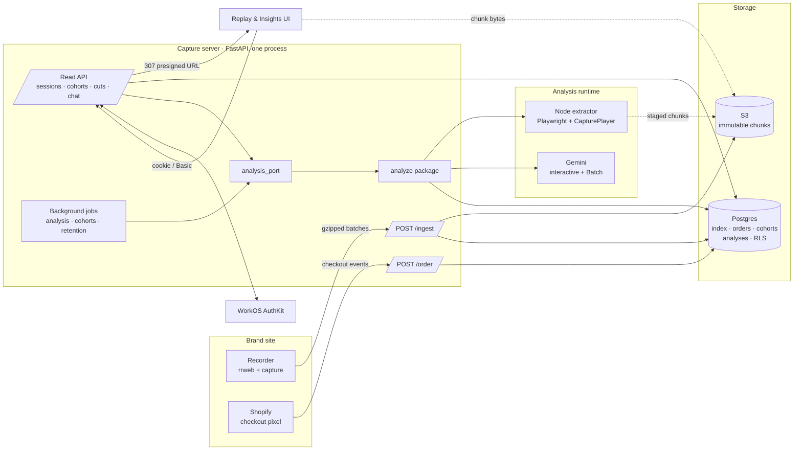
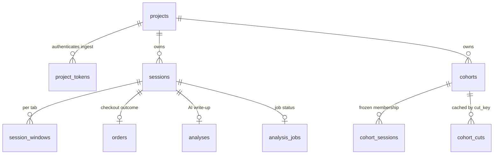
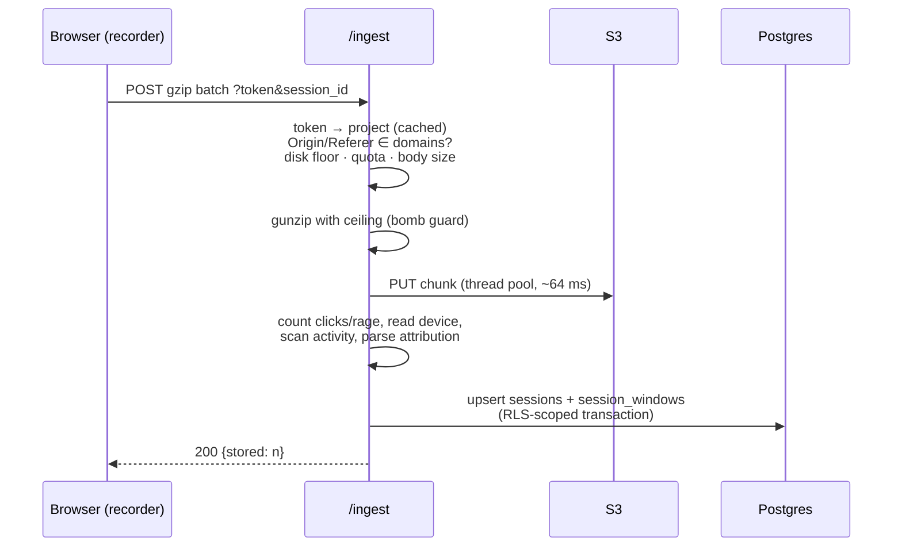

# Architecture

This document describes how Capture is built: its components, how data moves
between them, and the rules that hold it together. For *why* individual
subsystems look the way they do, and what breaks if you "simplify" them, see
[docs/deep-dive/](docs/deep-dive/README.md).

---

## 1. System overview



There are two independent paths:

- **The write path** (`/ingest`, `/order`, `/config`, recorder bundles) runs on
  *other people's* pages. It is unauthenticated, must never slow down the host
  page, and must withstand abuse from a public token.
- **The read path** (`/replay.html`, `/api/*`) serves a brand's own team. It is
  authenticated and tenant-scoped, and it is where all analysis happens.

---

## 2. Components

### 2.1 Recorder: `src/recorder/`

Bundled by esbuild into `public/recorder.bundle.js`. The documented snippet
injects it from `requestIdleCallback` after the page has loaded, so an outage
on our side cannot affect the host page.

| Module | Responsibility |
|---|---|
| `config.js` | Merges settings in order: built-in defaults, then remote `/config` (cached in `localStorage` for 1 h), then inline `window.CAPTURE_CONFIG`. The page always wins. |
| `identity.js` | Session id (rotates after 30 min idle or 24 h), per-tab window id, a pseudonymous visitor id, opt-out. |
| `recording.js` | rrweb `record()` with all inputs masked, plus mousemove and scroll throttling and a full-snapshot checkpoint every 5 min. |
| `transport.js` | Buffers events and flushes every 5 s, at 50 events, or at about 0.9 MB. Batches are gzipped with `CompressionStream`. A `keepalive` flush runs on `pagehide`, and failed sends are re-buffered up to a limit. |
| `triggers.js` | Optional trigger-gated recording: a bounded rolling buffer is held until a URL regex matches, an exception is thrown, or `capture.trigger()` is called. |
| `visibility.js`, `clicks.js`, `viewport.js` | Custom events for focus and visibility, clicks, rage clicks and viewport size. These drive the timeline and the derived columns in the session index. |
| `redact.js` | Strips listed parameters from URLs before they leave the browser. |

### 2.2 API server: `capture/`

A single FastAPI app (`capture/server.py`) with the routers in `capture/api/`:

| Router | Endpoints |
|---|---|
| `ingest.py` | `POST /ingest`, `POST /order` |
| `meta.py` | `GET /healthz`, `GET /config` |
| `auth.py` | `/login`, `/auth/callback`, `/logout` (WorkOS) |
| `sessions.py` | Session list and detail, the chunk manifest, chunk redirects, delete, and single-session analysis |
| `cohorts.py` | Cohort create, list, rename and delete; facets; analyze, pause and retry; `cut`; `chat` (SSE) |

Supporting modules:

| Module | Role |
|---|---|
| `db.py` | Async and sync psycopg pools; per-transaction tenant scoping; migrations |
| `projects.py` | Project registry: token lookup, domains, org mapping, cached |
| `sessionstore.py` | Session index reads and writes, all run under RLS |
| `storage.py` | Chunk storage on S3 or local disk, with presigned URLs and a local fallback |
| `classify.py`, `attribution.py` | Derived columns (outcome, device, landing page, UTM, Meta) computed at ingest |
| `jobs.py` | In-process registry of background tasks, plus staging chunks to disk for the extractor |
| `quota.py`, `retention.py` | Per-project byte quota; daily expiry sweep |
| `analysis_port.py` | The **only** module outside `analyze/` that may import it (enforced by a test) |

### 2.3 Analysis package: `capture/analyze/`

The package is split *by dependency depth*: leaf modules have strictly fewer
dependencies than the orchestrators that use them, and no module imports its
parent.

```
spec.py          CohortSpec + sampling constants          (leaf)
slices.py        the slice language: pure predicates      (leaf)
stats.py         measured cross-tabs and their gates      (slices)
labels.py        selection text and auto-labels           (slices)
cutfmt.py        normalises the model's cut JSON          (leaf)
prompts/         session.md · cut.md · chat.md
runtime.py       env config + the two concurrency gates
store.py         Postgres persistence for analyses and cohorts
storage.py       facade over store
cohort_state.py  status projection (derived, never trusted from storage)
sampling.py      SQL cohort sampling + facets
gemini.py        the paid edge: sync + Batch submit/poll/parse
session.py       extractor subprocess + single-session analysis
cohorts.py       cohort lifecycle + the Batch/sync job
cuts.py          cut cache keys, cut write-ups, chat context
```

### 2.4 Extractor: `src/analyze/extract.mjs`

A Node script, run as a subprocess, that launches headless Chromium through
Playwright and loads `replayer.bundle.js`, which is the same `CapturePlayer`
the replay UI uses. It steps through the session during **active time**
(any gap over 5 s without interaction is skipped) and captures a JPEG per
sampled second, capped at `ANALYZE_MAX_FRAMES` by thinning the frames evenly
rather than cutting off the end. It writes a digest (URLs, clicks, scroll
depth, timings, warnings) and the labelled frames to `.analysis/`.

### 2.5 Replay and Insights UI: `src/replay/`

Plain ES modules bundled into `replay.bundle.js`. The session list is paged by
cursor, and filtering and search run on the server. The player loads the first
chunk, starts playing, and streams the remaining chunks in through
`addEvent()`. Its seekbar shows activity density, and a timeline panel follows
the playhead and labels each gap as *idle*, *left the tab* or *switched
windows*. The Insights view creates cohorts, shows progress, renders cuts, and
streams chat. Citations such as `S4 [01:09]` are turned into deep links
(`#p=<project>&s=<session>&t=<ms>`).

---

## 3. Data model

All tenant tables have the composite key `(project_id, …)`, and every one is
protected by RLS (§5.1).



| Table | Notes |
|---|---|
| `projects` | One per brand. `org_id` maps to WorkOS; `domains` is the ingest allowlist; `storage_prefix` is the S3 key namespace. |
| `project_tokens` | Kept separate from `projects` so tokens can be rotated or revoked without rewriting the data keyed to a project. |
| `sessions` | The index. Raw facts (span, clicks, rage, device, entry URL, attribution JSON) plus **derived class columns** (`outcome`, `device_class`, `page`, `utm_*`, `is_meta`), materialised at ingest and indexed so cohort sampling is pure SQL. |
| `session_windows` | Per-tab activity state carried between chunks, so the activity scanner doesn't count each chunk's first event as a navigation. |
| `orders` | Rows from the Shopify pixel: `checkout_started_at`, `purchased_at`, order id and total. |
| `cohorts` / `cohort_sessions` | The cohort's selection rule (`fields`), status, and Batch job (`batch`). Membership is one row per session, so progress updates touch a single row. |
| `cohort_cuts` | Cached cut write-ups keyed by `cut_key` (slice plus prompt hash). |
| `analyses` / `analysis_jobs` | Single-session write-ups and their job state. |

Chunks are **not** stored in Postgres. Each one lives in S3 at
`sessions/<storage_prefix>/<session_id>/<ts>-<window>-<rand>.json`. Chunks are
written once, never modified, and deleted only by retention or erasure.

---

## 4. Request flows

### 4.1 Ingest



Error codes are part of the recorder's contract. `429` (quota reached) means
drop the batch. `503` and `507` (database busy, disk full) mean re-buffer and
retry.

**What ingest fixes permanently.** Attribution is written with
`coalesce(existing, new)`, so the first write wins. Device comes from the first
viewport event. Clicks are accumulated in SQL. None of these can be recomputed
from the index later, which is why `capture/backfill.py` exists for the rare
case that requires it. See
[deep-dive 01](docs/deep-dive/01-ingest-analyze-seam.md).

### 4.2 Replay

1. `GET /api/sessions` returns a page of the index scoped to the project, with
   a cursor for the next page.
2. `GET /api/sessions/:id/chunks` returns the manifest. Window ids are encoded
   in the chunk filenames, so tabs are grouped without opening any chunk.
3. `GET /api/sessions/:id/chunks/:name` returns a **307 to a presigned S3
   URL** (`no-store` on the redirect; the object itself is `immutable` and
   cached for a day). Chunk bytes never pass through the origin server. If a
   chunk hasn't been copied to S3 yet, it is served from local disk.

### 4.3 Single-session analysis

```
POST /api/sessions/:id/analysis
  → jobs.analysis_tasks[(project_id, session_id)]
  → chunks_on_disk()      stage only the missing chunks from S3; remove only what was staged
  → extract gate (1)      node extract.mjs → digest.json + frames
  → model gate (3)        Gemini interactive: system prompt + metadata + digest + [MM:SS] frames
  → analyses row          the UI polls GET …/analysis
```

The session metadata sent to the model (entry URL, UTMs, outcome, order value)
lists only the fields that are present. A missing key means *unknown*, and the
prompt says so, so the model doesn't take an empty value as evidence of direct
traffic.

### 4.4 Cohort analysis

A cohort has six persisted statuses (`idle`, `queued`, `running`, `paused`,
`done`, `error`). While a cohort is `running`, `run_cohort_job` moves through
these phases, which are not stored as statuses:

```
extract each session ──► submit Batch ──┬─► job name persisted ──► poll ──► match results by key ──► done
   (extract gate)                       │        ▲
                                        │        └── server restart: lifespan resumes the poll
                                        └─► submission failed: synchronous Gemini (the only fallback point)
```

1. **Sampling** (`sampling.py`). A `CohortSpec` (groups `a_n` and optional
   `b_n`, slice filters, time window, minimum duration, order) is compiled to
   `WHERE … ORDER BY … LIMIT n` against the derived columns. The result is
   **frozen**: membership and the full selection rule are stored together,
   because later cuts are only meaningful against a fixed population.
2. **Extraction** runs one session at a time behind the extract gate. Digests
   already in S3 are reused, so a second run skips Chromium.
3. **Write-ups** (`gemini.py`). Requests are streamed into a temporary JSONL
   file and submitted as a Gemini Batch job. The job name is persisted
   immediately; it is the recovery token. On startup the lifespan hook queries
   `cohorts_resumable` and resumes polling every in-flight batch.
4. **Status** (`cohort_state.py`) is a *projection*. Terminal states are
   recomputed from `cohort_sessions` on every read, never trusted from the
   stored `status`.

### 4.5 Cuts and chat

```
GET /api/cohorts/:id/cut?outcome=…&device=…&utm_source=…
  → filter the analysed rows with slices.row_matches_slice
  → stats.cross_tab_block      measured splits that pass 3 gates, plus "examined and not reported"
  → cut_key = (slice, sha256(cut.md)[:8])
  → cohort_cuts hit?  return cached
                miss? Gemini → cutfmt.normalize → store → return
        (citations S<n> resolve positionally against the stored session_ids)

POST /api/cohorts/:id/chat     (SSE)
  → same slice, same evidence block as the cut
  → history capped at 12 turns, nothing cached
```

---

## 5. Cross-cutting concerns

### 5.1 Multi-tenancy

- **Identity:** `project_id` (UUID). Tokens map to a project; storage is
  addressed by `storage_prefix`.
- **Enforcement:** `db.connection(project_id)` opens a transaction and runs
  `set_config('app.project_id', $1, true)`, which is transaction-local. Every
  tenant table has
  `ENABLE` and `FORCE ROW LEVEL SECURITY` with the policy
  `project_id = current_project() OR is_admin_scope()`. `FORCE` makes the
  policy apply to the table owner too.
- **Read authorisation:** a WorkOS session cookie (HMAC-signed, 7 days) holds
  the user's identity. The user's organisations are looked up live (cached for
  `ORG_CACHE_TTL_S`), and a project is readable when its `org_id` is one of
  them. Operators can read every project. Without WorkOS, a single
  `REPLAY_PASSWORD` is used. With no auth configured at all, the read side
  returns 503; it never serves recordings openly.
- **Write authorisation:** none, by design, because the token is public. The
  write path is defended by the domain allowlist, quota, disk floor, body-size
  limit and decompression ceiling.

### 5.2 Concurrency model

| Resource | Mechanism |
|---|---|
| Postgres | `AsyncConnectionPool` for all request work. The sync pool is only for the CLI and migrations, and `test_event_loop_contract.py` fails if a coroutine reaches it. |
| Blocking I/O (S3 PUT, file staging) | `asyncio.to_thread` on a default executor sized to `CAPTURE_DB_POOL_MAX` |
| Chromium (memory-bound) | Extract gate, 1 by default |
| Gemini (network-bound) | Model gate, 3 by default |
| Pool exhaustion | `PoolTimeout` → `503 Retry-After: 1`, which the recorder retries |

Both gates are created lazily inside the running event loop and live in one
module (`runtime.py`). If they were split across modules, each module would
get its own limit.

**Single worker, on purpose.** The job registry (`jobs.py`) and the quota
counter (`quota.py`) live in process memory. A second uvicorn worker would run
every job twice and see only about half of each project's usage. Scaling out
means moving both into Postgres first (§7).

### 5.3 Failure and recovery

| Failure | Behaviour |
|---|---|
| Process restart during a cohort's Batch wait | Resumed at startup from the persisted job name. Nothing is billed again. |
| Process stop during a single-session analysis | `stop_all()` marks the job `error: server restarted`, so no task is left claiming to run. |
| Batch poll errors | Up to `ANALYZE_BATCH_POLL_MAX_ERRORS` consecutive errors are tolerated before the server stops watching; the job can be resumed later. |
| Batch job that never finishes | Polling gives up after `ANALYZE_BATCH_MAX_WAIT_S`; the job name stays stored so the batch can be resumed. |
| One session fails extraction | Marked failed on its own; the rest of the cohort continues, and the session can be retried with `POST …/retry`. |
| Unreadable chunk | Reported as a warning in the digest instead of silently creating a gap that looks like idle time. |
| Database unreachable at boot | The server starts degraded and logs the failed resume instead of refusing to serve. |

### 5.4 Caching

| What | Where | Invalidated by |
|---|---|---|
| Recorder and loader bundles | CDN and browser, 1 h, `stale-while-revalidate` and `stale-if-error` for 1 day | Expiry. A health problem on our side never blocks a customer's page. |
| Chunks | Browser, 1 day, `immutable` | Never; chunks are write-once |
| Remote config | Visitor's `localStorage`, 1 h | TTL |
| Project registry, org membership | Process memory | `CAPTURE_PROJECT_CACHE_TTL_S`, `ORG_CACHE_TTL_S` |
| Session digests and frames | S3 `.analysis/` | Re-analysing the session |
| Cut write-ups | `cohort_cuts` | A change to the slice or the prompt's content hash, or `refresh=1` |

### 5.5 Privacy

The browser masks every input before data leaves the page. The
`capture-block` and `capture-mask` classes and selectors extend masking to
page content, and URL parameters can be redacted. Global Privacy Control is
honoured, and there is an optional consent gate. Visitor ids are pseudonymous
and per browser. The session prompt tells the model not to infer sensitive
personal characteristics.

---

## 6. Build, test and deploy

```
npm run build
  src/recorder/index.js        → public/recorder.bundle.js
  src/replay/index.js          → public/replay.bundle.js (+css)
  src/snippet.js               → public/capture.js
  src/analyze/replayer-entry.js → src/analyze/replayer.bundle.js   (used by the extractor)
  web/*.html                   → public/
```

**Tests.** `tests/client` runs under `node --test`. `tests/server` boots real
uvicorn subprocesses against a throwaway database and data directory, so it
exercises middleware order, environment parsing and status codes as they
ship. The `unit` marker is enforced: a unit test that opens a database
connection fails. Contract tests pin the architecture's rules:
`test_analysis_port.py` (only one way into `analyze`), `test_event_loop_contract.py`
(no sync pool on the event loop), `test_tenancy.py` (RLS isolation), and
`test_patch_contract.py` (patches applied where the patched function is defined).

**CI** (`.github/workflows/test.yml`) has three jobs. *lint* runs ruff, mypy
and the unit tier, in about 20 s with no database. *test* runs against
Postgres 18 with `CAPTURE_REQUIRE_POSTGRES=1` and reports coverage as advisory
only. *audit* runs pip-audit and is non-blocking.

**Deploy** (`scripts/deploy.sh`). The script builds and tars an allowlist of
files, then unpacks it into `/opt/capture/releases/<utc>-<sha>` with its own
venv and node_modules. It boots the release on a spare port with
`CAPTURE_PREFLIGHT=1` and checks `/healthz`. Only after that check passes does
it migrate, repoint the `current` symlink and restart systemd. The last three
releases are kept, so a rollback is a single symlink change.

---

## 7. Known limits and next steps

| Limit | Why it exists | Path forward |
|---|---|---|
| One worker per box | The job registry and quota counter live in process memory | Move the quota check into SQL; claim jobs with `SELECT … FOR UPDATE SKIP LOCKED` |
| Retention runs inside the server | It is a simple daily loop on the event loop | An external scheduler, if a window shorter than a day is ever needed |
| Extraction runs on the API box | Chromium shares memory with request handling | A separate extraction worker. The process boundary (a directory of chunks in, digest and frames out) already allows it |
| Cohorts are capped at 500 sessions | Each session costs one Chromium run plus model tokens | A cost and memory limit rather than a schema one; raise it alongside a separate worker |

The wire format and storage layout don't depend on any of these. Moving ingest
behind a queue, or extraction onto separate workers, requires no change to the
recorder.

---

## Further reading

- [docs/deep-dive/](docs/deep-dive/README.md): the constraints behind each
  subsystem, and what breaks when they are violated
- [docs/analyze-design-review.md](docs/analyze-design-review.md): how the
  analysis package was split into modules and why
- [docs/integration.md](docs/integration.md): the integration guide for brands
- [docs/rds-setup.md](docs/rds-setup.md): database setup and cutover
