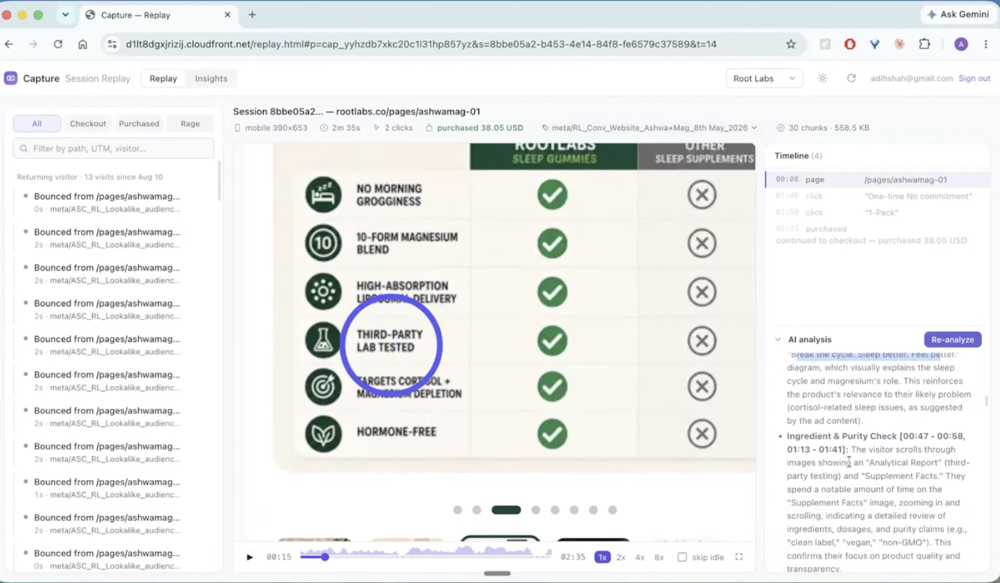
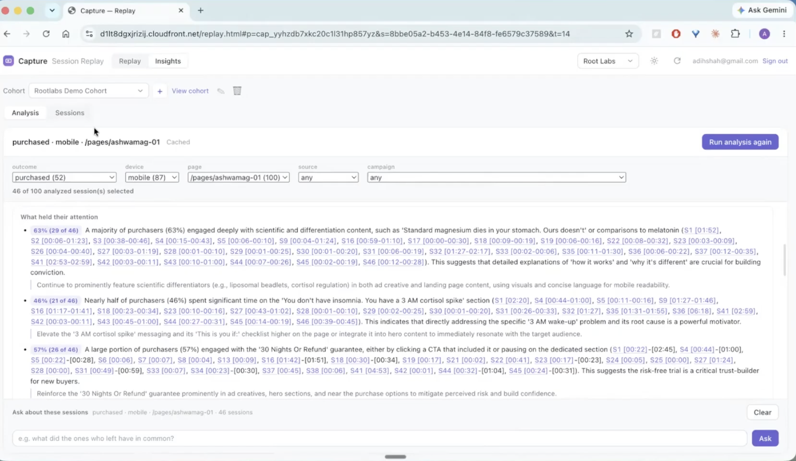
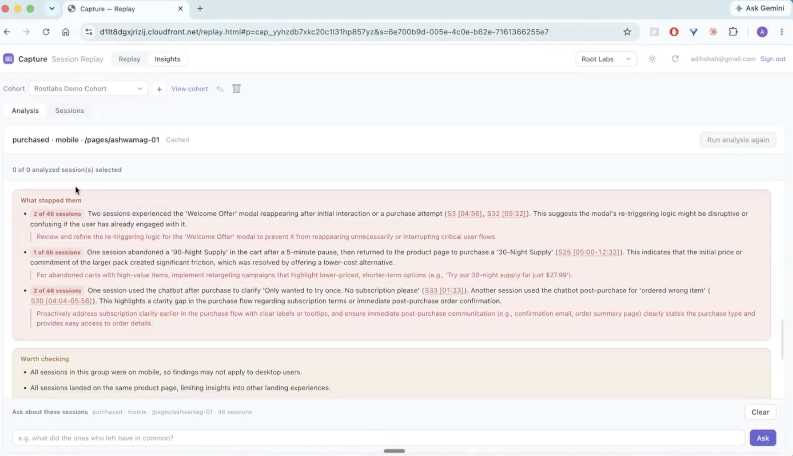

# Capture

**Session replay that tells a brand *why* visitors didn't buy, and which campaign sent them.**

Capture records real shopper sessions on a brand's storefront, replays them as
pixel-accurate DOM reconstructions, and then does what replay tools usually
leave to an analyst. It watches the sessions headlessly, writes up each one, and
turns a sample of them into findings a marketing or UX team can act on. Every
finding comes with exact percentages and links back to the moment in the
recording that proves it.

It is multi-tenant and self-hosted. One deployment serves many brands, and
Postgres row-level security keeps each brand's recordings separate.

---


## Demo 

Video: [https://youtu.be/MpstHOxRkeQ](https://youtu.be/MpstHOxRkeQ)

Screenshots: 

**You don't have to watch the recording.** Every session is tied to the ad
campaign that sent the visitor and to whether they bought. Capture writes up
each one: what the visitor read, what they lingered on, and what convinced
them. A 2.5-minute replay becomes a paragraph you can skim in seconds.



**Know which parts of your page sell.** Capture analyzes dozens of buyers at
once and tells you what actually moved them, for example: "63% of purchasers
engaged deeply with the science content" and "57% engaged with the 30-night
guarantee." Each claim links to the exact second in every recording that backs
it, and comes with a concrete change to make to your ads or landing page.



**Find the friction that's costing you sales.** Capture surfaces the problems
nobody reported: a welcome popup that keeps reappearing mid-purchase, a large
pack abandoned on price, and shoppers confused about whether they were
subscribing. Each problem comes with a fix. Capture also flags the limits of
its own sample, so you know how far a finding goes. Ask follow-up questions in
plain English, such as "what did the ones who left have in common?"



## The problem

Direct-to-consumer brands spend most of their budget buying traffic: Meta ads,
paid search, influencer links. Their analytics tell them *what* happened:
conversion fell 12% on mobile, or the new campaign's landing page bounces at
70%. They do not tell them *why*.

Session replay tools close part of that gap. You can watch the visitor
hesitate on the size selector, scroll past the guarantee, and leave. But a
brand records thousands of sessions a day, and nobody watches thousands of
videos. Teams end up watching a handful, anecdote wins over evidence, and the
replays sit unwatched.

## What Capture does about it


| For the team     | What they get                                                                                                                                                                                                                                         |
| ---------------- | ----------------------------------------------------------------------------------------------------------------------------------------------------------------------------------------------------------------------------------------------------- |
| **Marketers**    | Behaviour tied to the campaign that bought the click. A session that arrived from `utm_campaign=spring_sale` is read against the expectation the ad set, so the write-up says whether the landing page kept the ad's promise.                         |
| **UX / product** | Where the interface got in the way. The analysis separates "the offer didn't land" from "the information was there but the shopper couldn't find it when they needed it".                                                                             |
| **Growth / CRO** | A/B cohorts (purchased vs. abandoned at checkout, mobile vs. desktop, Meta vs. Google) compared side by side, with splits the system *measured* rather than ones the model guessed.                                                                   |
| **Everyone**     | Plain-language insights like *"44% (4 of 9) switched off the default 90-night supply after reading the guarantee; test 30-night as the default."* Each one cites the sessions behind it (`S3 [01:10]`), and a click opens that replay at that second. |


### The workflow

1. **Record.** The brand pastes one snippet (or installs it through GTM or
  Shopify). The recorder masks every form input by default and loads only
   after the page has finished loading, so Capture can't slow down or break
   the storefront even when Capture itself is down.
2. **Replay.** Anyone on the brand's team (signed in through WorkOS, scoped to
  their own organisation) can search, filter and watch sessions. Purchased,
   reached checkout, and rage-click badges come from a Shopify checkout pixel.
3. **Analyse one session.** *Analyze with AI* reconstructs the session in a
  headless browser, samples frames during active time only, and returns a
   consumer read, decision journey, objections and UX recommendations.
4. **Analyse a cohort.** Pick two groups, for example "mobile visitors from
  Meta who reached checkout" against "who purchased". Capture samples up to
   500 sessions, writes up each one through the Gemini Batch API (about 50%
   cheaper), and keeps a durable job that survives restarts.
5. **Cut and ask.** Slice the cohort by device, landing page, source or
  campaign to get a cached, cited write-up for that slice. Then ask follow-up
   questions in a streaming chat that answers only from the evidence in that
   slice.

---


## Technical highlights

Capture is about 15k lines of Python and JavaScript. The parts below are the
ones that took real engineering. [ARCHITECTURE.md](ARCHITECTURE.md) covers the
whole system, and [docs/deep-dive/](docs/deep-dive/README.md) records the
constraints behind each subsystem.

**Tenant isolation is enforced by the database.** Every tenant table has
`FORCE ROW LEVEL SECURITY` with a policy keyed on a per-connection
`app.project_id`. A query that forgets its `WHERE project_id = …` returns
nothing rather than another brand's recordings. CI runs against a real
Postgres 18 with a flag that stops the isolation tests from quietly skipping.

**The headless extractor reuses the replay player.** rrweb events are DOM
mutations, not a description of the page, so parsing them can't tell you what
the visitor saw. The analyser launches Playwright and drives the *same*
`CapturePlayer` the replay UI uses. That keeps frozen animations and
re-applied scroll offsets identical between what an analyst watches and what
the model reads. Frames are sampled per second of *active* time and dead air
is skipped, so a 20-minute session with 90 seconds of interaction costs 90
frames. Each frame gets its `[MM:SS]` text label before the image.

**The model interprets and Python computes the numbers.** Asked to count
across dozens of write-ups, LLMs invent plausible shares. Capture computes
every cross-tab (source × outcome, page × outcome, device × outcome, and
others) in Python and hands the model exact figures to quote. Three gates
(minimum cell size, minimum coverage, minimum lift) suppress noise. Splits that
fail a gate are still listed under *Examined and not reported*, so the model
doesn't read silence as uniformity.

**Batch processing that doesn't double-bill.** Cohort write-ups go through
Gemini Batch. Requests are streamed to a JSONL file instead of built in memory,
a change that came from a real out-of-memory incident. Only *submission* may
fall back to the synchronous API. Once a batch exists, its name is persisted
as the recovery token, and a server restart resumes polling instead of paying
for the cohort twice. Results are matched by key, never by order.

**Caches keyed on the prompt's content.** A cut's cache key includes a SHA-256
of the prompt that produced it. Editing a prompt invalidates exactly the
answers that prompt generated, with no version number for anyone to remember
to bump.

**Job status is derived on read.** A cohort's stored status goes stale the
moment a process dies mid-run. Terminal states are recomputed from per-session
rows instead of trusted from the record, so a crash leaves nothing reporting
"running" with no task behind it.

**Async all the way to Postgres.** The server runs on psycopg's
`AsyncConnectionPool`. A test enforces that the sync pool is never reached
from a coroutine. The thread executor is sized to the database pool, and pool
exhaustion returns `503 Retry-After`, which the recorder retries, instead of a
`500`, which it would drop.

**Replay bytes skip the origin server.** Chunks are immutable objects in S3.
The API answers a chunk request with a short-lived presigned redirect, so a
long session streams straight from S3 into the player while it plays.

**A recorder built for someone else's storefront.** It sends gzipped batches
via `CompressionStream` and flushes on time, count or byte size, with a
`keepalive` flush on `pagehide`. It drops background mutations while the
visitor is idle and takes a fresh snapshot when they return. Visibility
tracking separates *walked away* from *sat there hesitating*. Optional
trigger-gated recording keeps a bounded rolling buffer and starts sending only
when a checkout URL or an exception fires. It honours Global Privacy Control
and has a consent gate.

**A tested and gated delivery pipeline.** About 800 tests. Server tests boot a
real uvicorn subprocess, so they cover middleware order and environment
parsing as deployed. A `unit` tier runs in about a second and fails any test
that opens a database connection. Every change goes through ruff, mypy and
pip-audit in CI. Deploys build an immutable release directory, health-check it
on a spare port, and switch a symlink only after it passes. Rolling back means
pointing the symlink at an earlier release.

---


## Stack


| Layer             | Technology                                                                     |
| ----------------- | ------------------------------------------------------------------------------ |
| Recorder          | rrweb, vanilla JS bundled by esbuild                                           |
| API server        | Python 3.11, FastAPI, uvicorn, psycopg 3 (async pool)                          |
| Database          | PostgreSQL 16+ with row-level security (RDS in production)                     |
| Recording storage | S3, with presigned reads; local disk in development                            |
| Analysis          | Node and Playwright (headless Chromium), Google Gemini (interactive and Batch) |
| Auth              | WorkOS AuthKit (per-organisation logins) or HTTP Basic                         |
| Hosting           | EC2 behind CloudFront                                                          |


---


## Quick start

```bash
npm install                                   # esbuild, rrweb, playwright
python3 -m venv .venv
.venv/bin/pip install -r requirements.txt -r requirements-dev.txt
cp .env.example .env                          # add GEMINI_API_KEY to enable analysis
npm run dev                                   # build bundles, start on :3000 with auth off
```

- Demo page (instrumented): [http://localhost:3000/](http://localhost:3000/)
- Replay and insights UI: [http://localhost:3000/replay.html](http://localhost:3000/replay.html)
- Trigger-gated recording demo: [http://localhost:3000/demo-triggers.html](http://localhost:3000/demo-triggers.html)

Without `CAPTURE_S3_BUCKET`, chunks are written under `data/`. Postgres
connection settings and production setup are in
[docs/rds-setup.md](docs/rds-setup.md).

### Tests and lint

```bash
npm test             # build, then client tests (node --test) and server tests (needs Postgres)
npm run test:fast    # the database-free unit tier, about 1s
npm run lint         # ruff check, ruff format --check, mypy
npm run test:coverage
.venv/bin/pre-commit install   # catch formatting before CI does
```

---


## Onboarding a brand

```bash
python -m capture.cli add-project "Acme"                # prints the token and the snippet
python -m capture.cli set-domains cap_xxx acme.com      # optional: only accept ingest from acme.com
python -m capture.cli set-org cap_xxx org_yyy           # tie the project to the brand's WorkOS organisation
python -m capture.cli invite teammate@acme.com cap_xxx  # emails a login link
```

Send the brand [docs/integration.md](docs/integration.md). It covers the
snippet, GTM, the Shopify theme and checkout pixel, CSP, privacy defaults, and
how to verify the install.

Project tokens are public, because they appear in page source. They can only
*send* recordings, never read them. Ingest is protected by the domain
allowlist, a per-project storage quota, a free-disk floor and a gzip-bomb
ceiling.

## Configuration

Settings are read from the environment, and from `.env` in development. The
most important ones:


| Variable                                                             | Purpose                                                                                                                      |
| -------------------------------------------------------------------- | ---------------------------------------------------------------------------------------------------------------------------- |
| `CAPTURE_DATABASE_URL` / `CAPTURE_DB_POOL_MAX`                       | Postgres connection and per-pool size                                                                                        |
| `CAPTURE_S3_BUCKET`                                                  | Store chunks in S3 instead of on local disk                                                                                  |
| `WORKOS_API_KEY`, `WORKOS_CLIENT_ID`, `CAPTURE_OPERATORS`            | Per-organisation logins; operators can see every project                                                                     |
| `REPLAY_PASSWORD`                                                    | Single-operator HTTP Basic fallback. With no auth configured, the read side returns 503 instead of serving recordings openly |
| `GEMINI_API_KEY`, `GEMINI_MODEL`                                     | Turn on AI analysis                                                                                                          |
| `ANALYZE_FPS`, `ANALYZE_MAX_FRAMES`, `ANALYZE_BATCH`                 | Frame sampling density, frame cap, and Batch vs. synchronous calls for cohorts                                               |
| `RETENTION_DAYS`                                                     | Daily sweep of expired sessions (default 30; `0` keeps them forever)                                                         |
| `MAX_PROJECT_BYTES`, `MIN_FREE_DISK_BYTES`, `MAX_DECOMPRESSED_BYTES` | Ingest abuse limits                                                                                                          |
| `CAPTURE_READ_ONLY`                                                  | Serve a mirror of a database without writing to it                                                                           |


The recorder is configured remotely per project (sample rate, triggers,
masking selectors), so recording behaviour can change across every site
without editing any brand's page. `window.CAPTURE_CONFIG` on the page always
wins. The full list of keys is in [docs/integration.md](docs/integration.md).

## Deployment

```bash
scripts/deploy-staging.sh   # same flow, staging host
scripts/deploy.sh           # build, ship, preflight on a spare port, migrate, switch symlink, health-check
```

`GET /healthz` reports whether storage is writable, how much disk is free,
whether the bundles exist, and whether the analysis runtime is present.

## Data handling

- Every input is masked in the browser before it leaves the page.
`capture-block` and `capture-mask` classes, or selectors, extend masking to
page content.
- Visitor ids are pseudonymous and per browser. There is no identify call and
no cross-device linking.
- Erasure: the *Delete* button on a session, or
`python -m capture.cli remove-project <token> --purge`. Retention runs daily.


## Repository map

```
capture/          Python server: one FastAPI app
  api/              routes: ingest, sessions, cohorts, auth, meta
  analyze/          the analysis pipeline (sampling, Gemini, cohorts, cuts, stats)
  analysis_port.py  the only door from the web layer into analyze/
src/
  recorder/         runs on the brand's site
  replay/           the replay and insights UI
  analyze/          the headless extractor (Node + Playwright)
web/              HTML sources (built into public/)
migrations/       ordered SQL migrations
tests/            client (node --test) and server (unittest/pytest) tests
docs/             integration guide, RDS setup, design reviews, deep dives
```

